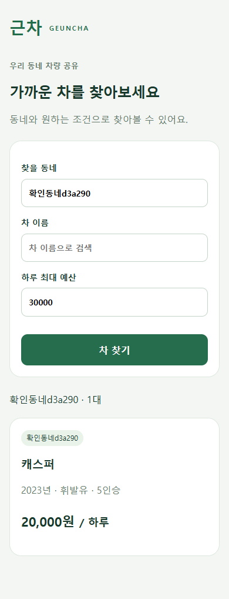
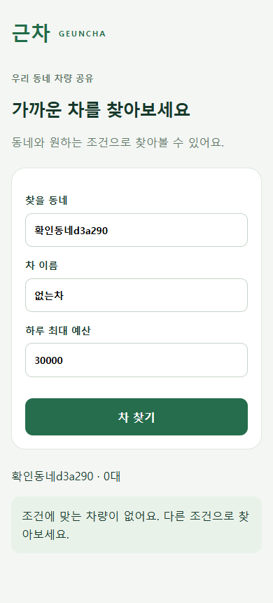

# 동네 차량 검색

동네·차 이름·최대 예산으로 공개 차량을 찾는다. 조건은 주소에 남겨 새로고침해도 유지한다.

## 만든 순서

| 작업 | 커밋 |
| --- | --- |
| 설계 | bc7da91 동네에서 차 찾을 때 필요한 내용 정리 |
| 화면 | 61bb9a8 동네랑 차 목록 나오는 화면 만듦 |
| 데이터 정리 | c76bf06 차 정보랑 검색 조건 따로 정리 |
| 동작 연결 | bb3d480 동네랑 예산으로 실제 차 목록 찾게 연결 |
| 확인 | 이 문서와 테스트·캡처를 함께 커밋 |

## 직접 확인한 내용

- MariaDB에서 공개된 차량만 조회하고 초안은 제외한다.
- 예산 조건으로 결과가 달라지고 차량번호는 응답에 넣지 않는다.
- 새로고침 후 조건과 결과가 유지된다.
- 빈 목록과 연결 실패를 구별하고 실패 후 다시 찾을 수 있다.
- 이전 검색 응답이 늦게 와도 현재 결과를 덮지 않는다.

## 검사

2026-11-24 Windows / Node.js v24.15.0

- npm run typecheck: 통과
- npm test: 3개 통과
- npm run test:browser: 실제 MariaDB와 Chrome에서 위 동작 확인
- npm run build: 통과

브라우저 검사는 별도 개발 DB에서 전용 확인 자료를 만들고 실행한다. 테스트가 만든 자료만 지운다.

## 남은 기능

지도·날짜별 가용 차량·상세·예약·결제는 아직 구현하지 않았다.
