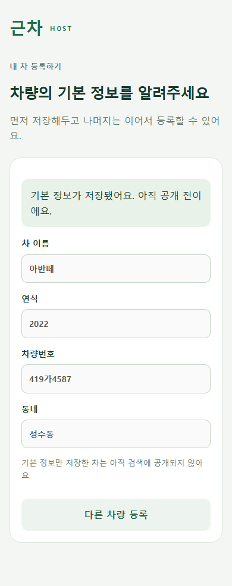
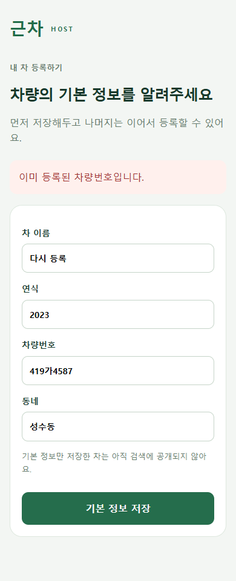

# 차량 기본 정보 저장

호스트 세션으로 차량명·연식·차량번호·동네를 초안으로 저장하고 다시 조회한다.

## 만든 순서

| 작업 | 커밋 |
| --- | --- |
| 설계 | 5259bac 차 등록할 때 받을 내용 정리 |
| 화면 | a0ac044 차 이름이랑 번호 적는 화면 만듦 |
| 데이터 정리 | 598fe5d 차량 입력값이 맞는지 확인하는 부분 추가 |
| 동작 연결 | d6ca670 등록한 차 저장하고 다시 열 수 있게 함 |
| 확인 | 이 문서와 테스트·캡처를 함께 커밋 |

## 직접 확인한 내용

- 실제 MariaDB에 저장하고 새로고침해서 같은 내용을 읽는다.
- 같은 제출을 연속으로 보내도 화면에서 중복 요청을 막는다.
- 저장한 차는 DRAFT이며 검색에 공개하지 않는다.
- 중복 번호는 거절하고 실패해도 입력값을 유지한다.
- 비회원·게스트 등록, 다른 호스트 차량 조회, 소유자 변조, 다른 사이트 요청을 차단한다.

## 검사

2026-11-24 Windows / Node.js v24.15.0

- npm run typecheck: 통과
- npm test: 3개 통과
- npm run test:browser: 실제 MariaDB와 Chrome에서 위 동작 확인
- npm run build: 통과

브라우저 검사는 별도 개발 DB에서 전용 확인 자료를 만들고 실행한다. 테스트가 만든 자료만 지운다.

## 남은 기능

차량 사양·사진·일정·공개·예약 승인과 수익 화면은 아직 구현하지 않았다.
