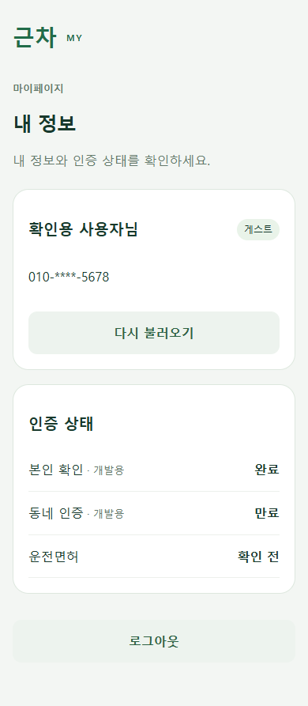
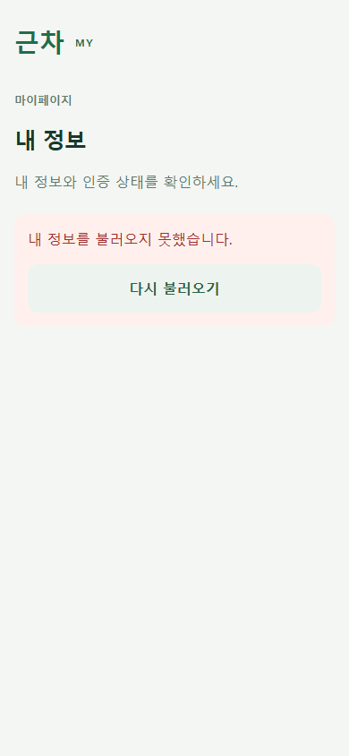

# 내 정보와 로그아웃

현재 세션의 이름·가린 전화번호·인증 상태를 보여주고 로그아웃한다.

## 만든 순서

| 작업 | 커밋 |
| --- | --- |
| 설계 | e1d9fd7 내 정보에 보여줄 내용 정리 |
| 화면 | aa08e23 이름이랑 인증 상태 보는 화면 만듦 |
| 데이터 정리 | 78ec1d4 내 정보랑 인증 상태 따로 정리 |
| 동작 연결 | e53bf90 내 정보 불러오기랑 로그아웃 연결 |
| 확인 | 이 문서와 테스트·캡처를 함께 커밋 |

## 직접 확인한 내용

- 로그인 전에는 로그인 안내를 보여주고 개발 모드에서 개발 계정으로 접속할 수 있다.
- 실제 DB에서 본인 자료만 읽고 전화번호 가운데를 가린다.
- 인증 완료·만료·확인 전을 구분한다.
- 자료가 바뀐 뒤 다시 불러오면 새 이름을 표시한다.
- 서버 실패 후 재시도할 수 있고 로그아웃하면 세션과 화면의 개인정보를 지운다.

## 검사

2026-11-24 Windows / Node.js v24.15.0

- npm run typecheck: 통과
- npm test: 3개 통과
- npm run test:browser: 실제 MariaDB와 Chrome에서 위 동작 확인
- npm run build: 통과

브라우저 검사는 별도 개발 DB에서 전용 확인 자료를 만들고 실행한다. 테스트가 만든 자료만 지운다.

## 남은 기능

프로필 수정·면허 변경·채팅·점검·정산·문의 등 다른 공용 화면은 아직 구현하지 않았다.
